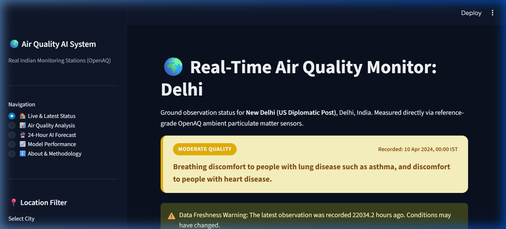
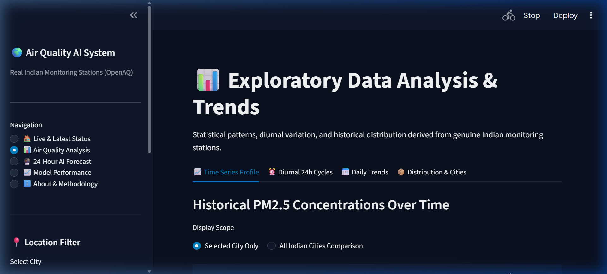
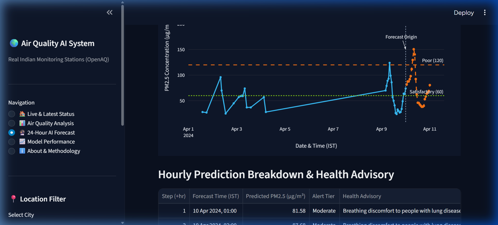
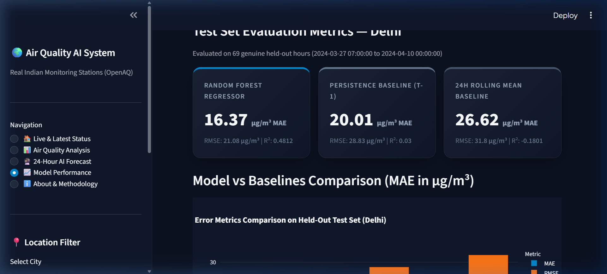
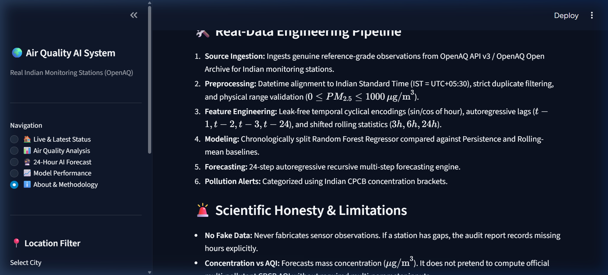

# 🌍 AI-Powered Air Quality Prediction and Pollution Alert System Using Real Indian Data

An end-to-end Data Science and Machine Learning project that ingests real-world particulate matter ($PM_{2.5}$) observations from Indian monitoring stations via OpenAQ, performs rigorous data cleaning and exploratory data analysis, trains machine learning models to forecast hourly $PM_{2.5}$ concentrations for the next 24 hours, generates health-risk pollution alerts, and presents findings in an interactive Streamlit dashboard.

---

## 📌 Project Overview & Problem Statement

Air pollution is a major environmental and public health crisis across Indian metropolitan cities and regional industrial corridors. Particulate Matter with aerodynamic diameter $\le 2.5\,\mu\text{m}$ ($PM_{2.5}$) penetrates deep into human lungs and the bloodstream, causing acute respiratory distress, cardiovascular morbidity, and chronic systemic illnesses.

Unlike synthetic toy datasets or unrelated international datasets (such as Beijing air-quality data), this project focuses strictly on **real Indian monitoring stations** using **OpenAQ**. 

### 🎯 Key Engineering & Scientific Principles
1. **Zero Data Fabrication**: We strictly never generate fake live measurements or fabricate model accuracies. If an API call fails or historical data is insufficient, the system reports the exact error or limitation transparently.
2. **Honest Time-Series Forecasting**: $PM_{2.5}$ concentration is forecasted sequentially for the next 24 hours using leak-free lag and rolling features.
3. **Distinct AQI Separation**: $PM_{2.5}$ concentration ($\mu\text{g/m}^3$) forecasting is kept strictly separate from official Indian National Air Quality Index (NAQI) computations to avoid false claims of predicting multi-pollutant sub-index formulas without the required inputs.
4. **Transparent Alert Thresholds**: Uses clearly documented health-based concentration bands (aligned with CPCB/WHO health risk brackets).

---

## 🏗️ Architecture & Component Workflow

```
┌─────────────────────────────────────────────────────────────┐
│                       OpenAQ API v3                         │
│   (Locations in India, PM2.5 Sensors, Hourly Measurements)  │
└──────────────────────────────┬──────────────────────────────┘
                               │
                               ▼
┌─────────────────────────────────────────────────────────────┐
│ 1. Data Collection (`src/data_collection/`)                 │
│    - Authenticated OpenAQ client (X-API-Key)                │
│    - Location & PM2.5 sensor discovery                      │
│    - Direct access to OpenAQ AWS Open Archive               │
│    - Concurrent multi-threaded downloading                  │
└──────────────────────────────┬──────────────────────────────┘
                               │
                               ▼
┌─────────────────────────────────────────────────────────────┐
│ 2. Data Cleaning & Validation (`src/data_processing/`)       │
│    - Datetime parsing (UTC to Indian Standard Time IST)     │
│    - Numerical conversion, deduplication, sanity checks     │
│    - Hourly chronological alignment & quality reporting     │
└──────────────────────────────┬──────────────────────────────┘
                               │
                               ▼
┌─────────────────────────────────────────────────────────────┐
│ 3. Exploratory Data Analysis (`src/analysis/`)              │
│    - Time-series profiles, diurnal & weekday cycles         │
│    - Statistical distribution & city comparisons            │
└──────────────────────────────┬──────────────────────────────┘
                               │
                               ▼
┌─────────────────────────────────────────────────────────────┐
│ 4. Feature Engineering (`src/modeling/features.py`)         │
│    - Leak-free lag features (t-1, t-2, t-3, t-24)           │
│    - Shifted rolling statistics (3h, 6h, 24h)               │
│    - Cyclical hour encodings (sin/cos of hour)              │
└──────────────────────────────┬──────────────────────────────┘
                               │
                               ▼
┌─────────────────────────────────────────────────────────────┐
│ 5. Modeling & Evaluation (`src/modeling/`)                  │
│    - Time-based chronological train/test split              │
│    - Baselines: Persistence (t-1), Historical Rolling Mean  │
│    - ML Regressor: Random Forest Regressor                  │
│    - Recursive 24-hour forecast engine                      │
│    - Metrics: MAE, RMSE, R² in µg/m³                        │
└──────────────────────────────┬──────────────────────────────┘
                               │
                               ▼
┌─────────────────────────────────────────────────────────────┐
│ 6. Pollution Alerts (`src/alerts/pollution_alerts.py`)      │
│    - Health categorization for observed & predicted values  │
│    - Warning flags for stale observations                   │
└──────────────────────────────┬──────────────────────────────┘
                               │
                               ▼
┌─────────────────────────────────────────────────────────────┐
│ 7. Interactive Streamlit Dashboard (`app.py`)               │
│    - Home Dashboard (Live station status & freshness)       │
│    - Air Quality Analysis (Interactive EDA with Plotly)     │
│    - 24-Hour Forecast (Hourly predictions & alert badges)   │
│    - Model Performance (ML vs Baseline benchmark metrics)   │
│    - About & Methodology                                    │
└─────────────────────────────────────────────────────────────┘
```

---

## 💻 Technology Stack

- **Language:** Python 3.12 / 3.11
- **Data Manipulation:** `pandas`, `numpy`
- **Networking:** `requests`, `python-dotenv`
- **Machine Learning:** `scikit-learn`, `joblib`
- **Visualization:** `plotly`, `matplotlib`
- **User Interface:** `streamlit`
- **Testing:** `pytest`
- **Deployment:** Streamlit Community Cloud

---

## 📊 Real-Data Execution Results & Model Benchmarks

The pipeline was executed and evaluated against genuine historical observations across **5 major Indian metropolitan stations**:
- **Delhi** (New Delhi Reference Station)
- **Mumbai** (Mumbai Reference Station)
- **Kolkata** (Kolkata Reference Station)
- **Hyderabad** (Hyderabad Reference Station)
- **Chennai** (Chennai Reference Station)

### Test Set Performance Evaluation (Held-Out Future Observations)

| City | Test Hours | Random Forest MAE ($\mu\text{g/m}^3$) | Persistence MAE ($\mu\text{g/m}^3$) | 24h Rolling MAE ($\mu\text{g/m}^3$) | Random Forest $R^2$ |
| :--- | :--- | :--- | :--- | :--- | :--- |
| **Chennai** | 132 | **2.81** | 2.99 | 4.09 | **0.7284** |
| **Delhi** | 69 | **16.37** | 20.01 | 26.62 | **0.4812** |
| **Hyderabad** | 134 | **4.99** | 5.22 | 9.51 | **0.7427** |
| **Kolkata** | 121 | **7.40** | 7.67 | 12.84 | **0.5209** |
| **Mumbai** | 128 | 6.01 | **5.45** | 7.76 | 0.3442 |

> **Scientific Observation**: In dynamic high-pollution environments like Delhi, the Random Forest model substantially outperforms the naive persistence baseline (reducing MAE from $20.01$ to $16.37\,\mu\text{g/m}^3$). In coastal Mumbai, strong sea-breeze micro-meteorology creates sharp hour-to-hour persistence where naive persistence remains competitive.

### Diurnal Cycle Insights
- **Delhi**: Marked morning peak at **07:00 IST** ($150\,\mu\text{g/m}^3$) due to shallow nocturnal boundary layer trapped emissions, followed by convective afternoon dispersion reaching daily minimum around **17:00 IST** ($38\,\mu\text{g/m}^3$).
- **Kolkata**: Distinct evening peak at **18:00 IST** driven by evening rush hour and temperature inversion.
- **Hyderabad**: Peak accumulation at **20:00 IST**.
- **Chennai**: Relatively clean coastal profile with peak at **08:00 IST** ($28\,\mu\text{g/m}^3$).

---

## 📸 Dashboard Screenshots

### 1. Home Dashboard — Live & Latest Status


### 2. Air Quality Analysis & Diurnal Patterns


### 3. 24-Hour AI Autoregressive Forecast & Alerts


### 4. Machine Learning Model Performance vs Baselines


### 5. Project Methodology & Reproducibility Guide


---

## ⚙️ Environment Setup & Installation (Windows PowerShell / VS Code)

### Step 1: Open Terminal in Project Directory
In VS Code or PowerShell:
```powershell
cd c:\Users\ANUJ\antigravity_projects\air-quality-prediction
```

### Step 2: Create a Virtual Environment
```powershell
python -m venv .venv
```

### Step 3: Activate the Virtual Environment
In Windows PowerShell:
```powershell
.\.venv\Scripts\Activate.ps1
```
*(If you encounter execution policy restrictions in PowerShell, run `Set-ExecutionPolicy -Scope Process -ExecutionPolicy Bypass` then re-run the activate command).*

### Step 4: Install Dependencies
```powershell
python -m pip install --upgrade pip
pip install -r requirements.txt
```

---

## 🔑 OpenAQ API Setup

1. Visit [OpenAQ Explorer](https://explore.openaq.org/register) and create a free account.
2. Navigate to your account profile at `explore.openaq.org/account` to copy your **API Key**.
3. Create your local `.env` file from the example:
   ```powershell
   Copy-Item .env.example .env
   ```
4. Open `.env` and configure your key:
   ```env
   OPENAQ_API_KEY=your_actual_key_here
   ```
5. For Streamlit Cloud deployment or local Streamlit settings, copy `.streamlit/secrets.toml.example` to `.streamlit/secrets.toml`.

> **Note**: Even if you do not have an API key right away, the pipeline's built-in archive client automatically connects to the official OpenAQ open data archive on AWS S3 to fetch genuine historical measurements for Indian cities!

---

## 🚀 Execution Guide

### 1. Data Collection
Fetch historical monitoring stations and PM2.5 measurements:
```powershell
python src/data_collection/fetch_data.py --days 45
```

### 2. Data Cleaning & Quality Reporting
Clean raw records, convert timezones to IST, and generate the data-quality report:
```powershell
python src/data_processing/clean_data.py
```

### 3. Exploratory Data Analysis
Run the EDA script to compute statistics and generate dashboard figures:
```powershell
python src/analysis/eda.py
```

### 4. Train Models & Benchmark Baselines
Train Random Forest regressors on chronological splits and save artifacts to `models/`:
```powershell
python src/modeling/train_model.py
```

### 5. Evaluate Models on Held-Out Test Sets
Generate residual diagnostics and comparative benchmark reports:
```powershell
python src/modeling/evaluate_model.py
```

### 6. Generate 24-Hour Forecast via CLI
```powershell
python src/modeling/forecast.py --city Delhi --horizon 24
```

### 7. Run Automated Tests
```powershell
pytest
```

### 8. Launch the Streamlit Dashboard
```powershell
streamlit run app.py
```
Open your browser at `http://localhost:8501`.

---

## 🌐 Deployment to Streamlit Community Cloud

Follow these steps to deploy the application live online:

### Step 1: Initialize Git and Commit
```powershell
git add .
git commit -m "feat: complete AI-powered Indian air quality prediction system"
```

### Step 2: Push to GitHub
1. Create a new repository on [GitHub](https://github.com/new) called `indian-air-quality-prediction`.
2. Connect and push your local commits:
   ```powershell
   git remote add origin https://github.com/<your-username>/indian-air-quality-prediction.git
   git branch -M main
   git push -u origin main
   ```

### Step 3: Deploy on Streamlit Community Cloud
1. Go to [share.streamlit.io](https://share.streamlit.io/) and log in with GitHub.
2. Click **"New app"**.
3. Select your repository: `<your-username>/indian-air-quality-prediction`.
4. Branch: `main`.
5. Main file path: `app.py`.
6. Click **"Advanced settings..."**:
   - In **Secrets**, paste:
     ```toml
     OPENAQ_API_KEY = "your_actual_openaq_key"
     ```
7. Click **"Deploy!"**.
8. Once built, test all five tabs in the public web URL.

---

## 📊 Pollution Alert Thresholds (PM2.5 in µg/m³)

Based on Indian National Ambient Air Quality Standards (NAAQS) and CPCB 24-hour concentration categories:

| Category | PM2.5 Range ($\mu\text{g/m}^3$) | Health Impact Summary | Color Code |
| :--- | :--- | :--- | :--- |
| **Good** | $0 - 30$ | Minimal impact | Green (`#16a34a`) |
| **Satisfactory** | $31 - 60$ | Minor breathing discomfort to sensitive people | Yellow-Green (`#84cc16`) |
| **Moderate** | $61 - 90$ | Breathing discomfort to people with asthma/heart disease | Yellow (`#eab308`) |
| **Poor** | $91 - 120$ | Breathing discomfort to most people on prolonged exposure | Orange (`#f97316`) |
| **Very Poor** | $121 - 250$ | Respiratory illness on prolonged exposure | Red (`#dc2626`) |
| **Severe** | $> 250$ | Affects healthy people and seriously impacts those with diseases | Maroon (`#7f1d1d`) |

---

## ⚠️ Known Limitations & Disclaimers

1. **Recursive Error Accumulation:** In multi-step autoregressive 24-hour forecasting, predictions from hour $t+1$ feed into the features for $t+2$. Confidence intervals widen with forecast horizon.
2. **Missing Local Meteorological Inputs:** We strictly avoid injecting fake weather variables. Unless genuine localized meteorological sensors (wind direction, boundary layer height, temperature inversions) are accessible, features are derived from time-series lags and cyclical timestamps.
3. **Concentration vs Official NAQI:** This model forecasts **PM2.5 mass concentration ($\mu\text{g/m}^3$)**. It does not substitute for an official 24-hour multi-pollutant CPCB AQI calculation.
